# DEGexplorer

An interactive R/Shiny workbench for exploring RNA-seq differential expression
results: publication-quality **volcano**, **MA**, **expression-scatter**,
**PCA + scree** and **heatmap** figures, **GO / KEGG / MSigDB** enrichment, an
**enrichment gallery** of ready-made GO and pathway figures, and an integrated **gene intelligence** panel that pulls together database links and
literature for your differentially expressed genes.

It reads output from **nf-core/differentialabundance** (DESeq2 *and* limma),
**edgeR**, or any table with a fold-change and a p-value column, and can compute
**TPM, FPKM/RPKM, CPM, DESeq2 median-of-ratios and edgeR TMM** matrices directly
from raw counts (e.g. `rsem.merged.gene_counts.tsv` from **nf-core/rnaseq**).

Its **Analysis** tab runs **DESeq2, limma-voom, edgeR and EBSeq** on gene or
transcript counts, and tests **differential transcript usage** with edgeR / limma
diffSplice, DEXSeq, DRIMSeq and satuRn, each set up as its authors recommend,
with QC, a run record and an R script that reproduces every number.

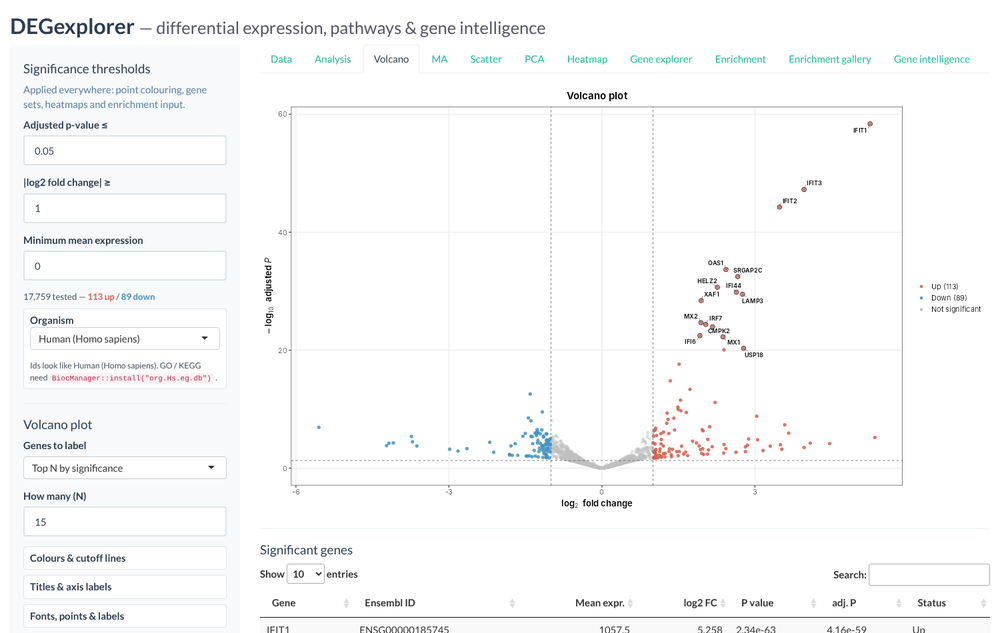 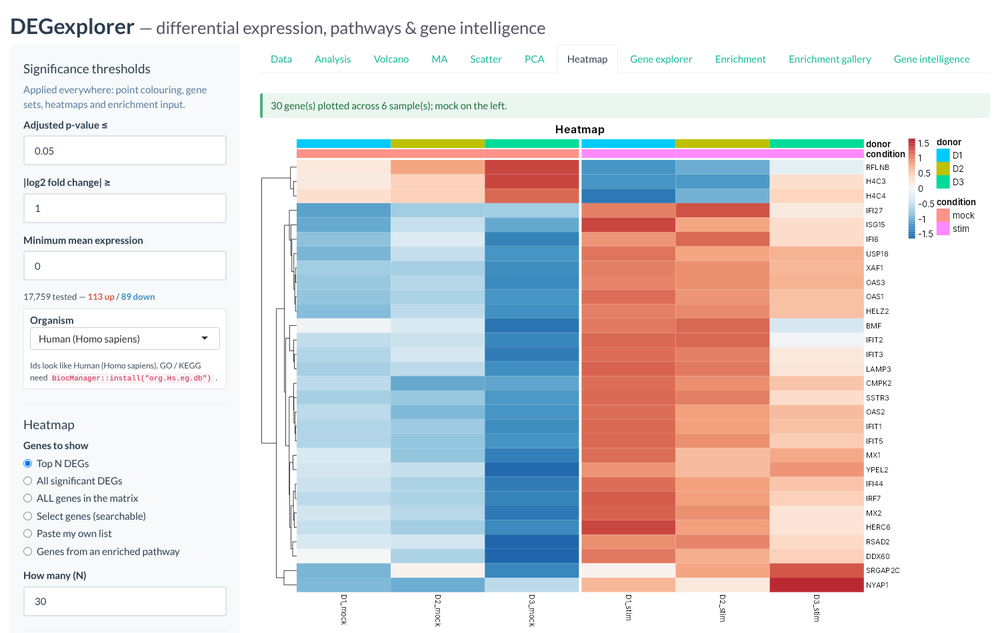

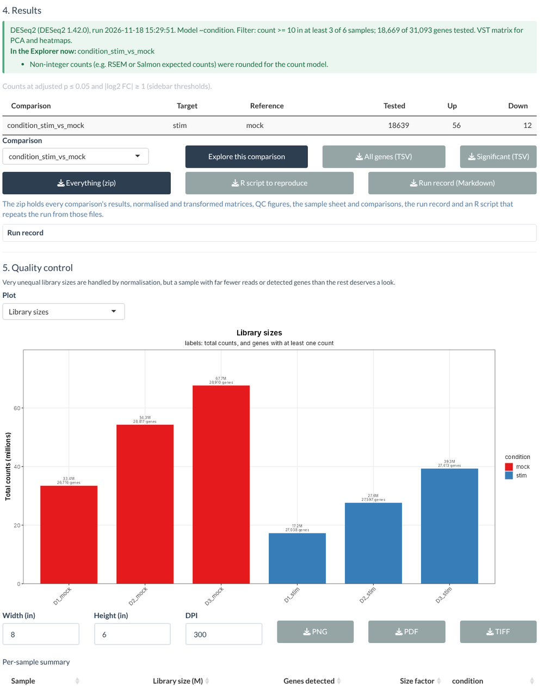

---

## Contents

- [Quick start](#quick-start)
- [Installing R packages](#installing-r-packages)
- [Input files](#input-files)
- [Features](#features)
- [Enrichment gallery](#enrichment-gallery)
- [Normalisation methods](#normalisation-methods)
- [Repository layout](#repository-layout)
- [Notes and limitations](#notes-and-limitations)
- [How to cite DEGexplorer](#how-to-cite-degexplorer)
- [Citing the resources used](#citing-the-resources-used)
- [Licence](#licence)

---

## Quick start

```r
# from the directory containing app.R
shiny::runApp()
```

or, from anywhere:

```r
shiny::runApp("path/to/DEGexplorer", launch.browser = TRUE)
```

The app opens with a bundled example (6 samples from 3 donors, each donor
`mock` and `stim`) so every panel is populated immediately. The example is
derived from an unpublished experiment: sample and group names are invented and
every count has been resampled with noise added, so it keeps the shape of the
biology (a strong interferon response) without reproducing any measured value.
It is for demonstration only. Replace it with your own study on the **Data** tab
at any time.

---

## Installing R packages

R ≥ 4.2 is recommended. `Rscript install_dependencies.R --all` installs
everything below.

**The exact tested setup.** `renv.lock` records the versions DEGexplorer 1.0.0
was tested with (R 4.6.1, Bioconductor 3.23). To reproduce them in a project
library, without touching your other R projects:

```r
install.packages("renv")
renv::restore(lockfile = "renv.lock")
```

**Required** (the app will not start without these):

```r
install.packages(c(
  "shiny", "ggplot2", "ggrepel", "pheatmap", "DT", "readr",
  "RColorBrewer", "matrixStats"
))
```

**Strongly recommended** (sidebar controls, Excel export, stacked figures):

```r
install.packages(c("shinyjs", "colourpicker", "shinythemes", "openxlsx", "gridExtra"))
```

**Optional — enrichment** (only needed for the Enrichment tab):

```r
if (!requireNamespace("BiocManager", quietly = TRUE)) install.packages("BiocManager")
BiocManager::install(c("clusterProfiler", "org.Hs.eg.db", "enrichplot"))
install.packages("msigdbr")   # Hallmark / Reactome / WikiPathways / ImmuneSigDB
```

**Optional — enrichment gallery extras.** The gallery's table-driven figures
need nothing beyond the required packages. These add the remaining pieces:

```r
install.packages(c("zip", "png"))        # results bundle; re-exporting pathway maps
BiocManager::install("pathview")         # KEGG pathway maps coloured by fold change
install.packages("ggarchery")            # arrows in the GO graph (recent enrichplot needs it)
# the GO graph uses enrichplot, GO.db and GOSemSim (installed with clusterProfiler)
```

**Optional — Analysis tab engines** (only the engines you use are needed):

```r
BiocManager::install(c("DESeq2", "limma", "edgeR", "EBSeq"))   # limma-voom also needs edgeR
install.packages("ashr"); BiocManager::install("apeglm")       # DESeq2 fold-change shrinkage (optional)
```

**Optional — live gene lookups** (Gene intelligence tab):

```r
install.packages(c("jsonlite", "curl"))
```

The app never fails silently on a missing package: each tab reports exactly
which `install.packages()` / `BiocManager::install()` line to run.

---

## Input files

Only the first file is mandatory. Everything else unlocks extra features.

| # | File | Needed for | Example (nf-core) |
|---|------|-----------|-------------------|
| 1 | **Differential expression results** | everything | `*.deseq2.results.tsv`, `*.limma.results.tsv` |
| 2 | **Raw / expected counts** (genes × samples) | scatter, PCA, all-genes heatmap, computed matrices | `rsem.merged.gene_counts.tsv` |
| 3 | **Gene lengths** (genes × samples, or one column) | TPM and FPKM only | `rsem.merged.gene_lengths.tsv` |
| 4 | **Pre-normalised matrix** (optional) | use your own VST/rlog instead of recomputing | `all.vst.tsv` |
| 5 | **Sample sheet** (CSV/TSV) | grouping for every plot | `sample,condition,donor` |
| 6 | **Gene annotation** (optional) | gene symbols when the results file has none | `*.gtf.gz` or `*.limma.annotated.tsv` |
| 7 | **Unfiltered results** (optional) | enrichment background when you loaded a filtered table | `*.limma.results.tsv` |

### nf-core/differentialabundance outputs

For every contrast the pipeline writes three flavours per method, and **all of
them can be dropped straight into box 1**:

| File | Contents | What the app does |
|---|---|---|
| `*.limma.results.tsv` | every gene tested, statistics only | loads as-is; add the annotated file to get gene symbols |
| `*.limma.results_filtered.tsv` | only genes passing the pipeline's cut-off | loads, and warns that it is pre-filtered — supply the unfiltered file as the enrichment background |
| `*.limma.annotated.tsv` | every gene plus GTF annotation and `gene_name` | the richest option; nothing else needed |

The same applies to `*.deseq2.*`. The app names what it found, e.g.
*"limma results (results_filtered)"*, and lists any
caveats above the column mapping.

Two companion slots on the Data tab handle the gaps in the leaner flavours:

- **Gene annotation** — a GTF/GFF3, or any table with a gene id and a symbol
  column. Missing symbols are filled in; symbols already present are never
  overwritten.
- **Unfiltered results** — supplies the gene universe for enrichment. Without
  it, a `results_filtered.tsv` would be tested against itself, which makes
  over-representation analysis meaningless; the app warns if you try.

The bundled example comes in all four layouts (built by
`data-raw/make_example_de_tables.R` from the example counts) — pick one from the
dropdown on the Data tab and press **Load bundled example**.

### Differential expression results

Column names are detected automatically, so the same app handles DESeq2 and
limma without any editing:

| Canonical field | Recognised names |
|---|---|
| gene id | `gene_id`, `GeneID`, `ensembl`, `id`, `row`, … (or any column of `ENSG…` accessions) |
| fold change | `log2FoldChange`, `logFC`, `log2FC`, `lfc`, `coefficient`, … |
| mean expression | `baseMean`, `AveExpr`, `logCPM`, `meanExpression`, … |
| p-value | `pvalue`, `P.Value`, `PValue`, `pval`, … |
| adjusted p | `padj`, `adj.P.Val`, `FDR`, `qvalue`, … |
| gene symbol | `gene_name`, `symbol`, `SYMBOL`, `hgnc_symbol`, … |

limma's `t` and `B` and DESeq2's `lfcSE` and `stat` are carried through
untouched and appear in the exported tables.

Matching ignores case, dots and underscores, so `adj.P.Val`, `adj_p_val` and
`AdjPVal` all resolve to the same field. If detection ever gets it wrong, open
**Column mapping** on the Data tab and choose the columns yourself.

Two conveniences worth knowing about:

- `AveExpr` (limma) and `logCPM` (edgeR) are log-scaled. They are converted back
  to a linear scale so the MA plot's axis stays meaningful, and the app says so
  in a note.
- If no adjusted p-value column exists, Benjamini–Hochberg FDR is computed from
  the raw p-values (again, with a note).

### Sample sheet

```csv
sample,condition,donor
D1_mock,mock,D1
D1_stim,stim,D1
...
```

The first column must match the count-matrix column names. A grouping column
named `condition`, `group`, `treatment`, `genotype`, … is found automatically.
Any further columns (`donor`, `batch`, `sex`) become available as heatmap
annotations and PCA colour/shape variables.

> **Matrices containing more than one study.** `rsem.merged.gene_counts.tsv`
> from nf-core/rnaseq holds *every* sample in the run. After selecting a count
> file, tick only the samples belonging to the comparison in **Samples to keep**
> before pressing *Load uploaded files*.

---

## Features

### Plots

| Tab | What it shows |
|---|---|
| **Volcano** | log2 fold change vs −log10 adjusted p, with cutoff guides |
| **MA** | log2 fold change vs mean expression |
| **Scatter** | mean expression per group on each axis with the identity line — the classic off-target figure; choose FPKM, TPM, CPM, DESeq2, TMM or raw, with optional log2 |
| **PCA** | sample scores on any two PCs, coloured and shaped by any metadata column, with optional group ellipses |
| **Scree** | variance explained per PC with a cumulative overlay |
| **Heatmap** | top-N, all significant, all genes in the matrix, a searched selection, a pasted list, or a pathway's genes |

Every plot exports to **TIFF (LZW)** and **PDF** at a width, height and DPI you
choose (default 7 × 6 in at 300 dpi).

### Full typography and geometry control

Each plot tab carries its own **Fonts, points & labels** panel: base font,
title, axis-title, tick-label and legend sizes; gene-tag size, weight, colour
and maximum overlap; point size, opacity and highlighted-point size; grid on or
off. **Titles & axis labels** lets you override the title, subtitle and both
axis labels — leave a field blank to keep the computed default.

### Gene selection, everywhere

Wherever a gene set is needed, the same nine modes are offered:

- none
- all significant DEGs
- top N by significance
- top N by |log2 fold change|
- up-regulated only (top N)
- down-regulated only (top N)
- searchable dropdown
- your own pasted list (symbols *or* Ensembl IDs; unmatched genes are reported back to you)
- the genes behind any enriched pathway

### Heatmap specifics

- **Control on the left, treated on the right.** Choose the reference group and
  leave *Cluster samples* off; columns are then ordered by group with an
  optional gap between them. (Turning sample clustering on hands column order to
  the dendrogram, and the app says so.)
- **All genes** mode plots the whole expression matrix, not just DEGs, so
  non-significant genes are included. A row cap keeps it responsive by retaining
  the most variable genes; the banner tells you when that happened.
- Row names hide themselves automatically above 120 rows.

### Analysis: differential expression from raw counts

The **Analysis** tab runs the differential expression inside the app, so you
can start from a count matrix instead of results computed elsewhere. Every
other tab then works on its output. Results from other tools still load on the
**Data** tab as before.

1. **Count matrix.** Upload raw counts (genes × samples), for example
   `salmon.merged.gene_counts.tsv`, `rsem.merged.gene_counts.tsv` or featureCounts
   output. Sample names are read from the column headers. Add a
   GTF/GFF3 (or an id–symbol table) for gene symbols. **Use the bundled example**
   loads the demo counts together with their design.
2. **Samples and variables.** Untick samples to leave them out. Add variables
   (factors such as `condition`, `donor`, `batch`, or numeric covariates) and fill
   them by editing cells, by setting a value for selected rows, or by splitting the
   sample names on a delimiter. No sample sheet file is needed.
3. **Model and comparisons.** Pick the main variable and any covariates or
   blocking factors; the model formula is shown (for example `~ donor + condition`).
   Add comparisons one at a time (reference and target) or every level against a
   reference. The design is checked before running: missing values, confounded
   covariates, single-level factors, designs that cannot be estimated, and
   comparisons with no samples are reported in plain language, along with how many
   genes the filter keeps.
4. **Run.** Choose the engine and its options in the sidebar and press **Run
   analysis**. The first comparison loads straight into the Explorer tabs; switch
   comparisons with **Explore this comparison**. Each comparison downloads as
   `<comparison>.<engine>.results.tsv` (all genes, or the significant ones) with
   gene symbols added.

Filtering is the same for every engine: a minimum count or CPM in the smallest
group, a number of samples, or a proportion of samples. Four engines are available; the sidebar shows each one's options.

| Engine | Test | Options | Matrix for PCA / heatmaps |
|---|---|---|---|
| **DESeq2** | negative binomial GLM, Wald test | dispersion fit, alpha, LFC threshold, independent filtering, Cook's cutoff | VST or rlog |
| **limma-voom** | voom precision weights + moderated t | normalisation (TMM, TMMwsp, upper quartile, RLE, none); `voom` or `voomWithQualityWeights`; eBayes trend and robust; a random blocking factor via `duplicateCorrelation`; TREAT for a fold-change threshold | voom log2-CPM |
| **edgeR** | quasi-likelihood F test (default) or likelihood ratio test | normalisation as above; robust dispersions; `glmTreat` for a fold-change threshold | log2-CPM (TMM) |
| **EBSeq** | empirical Bayes, posterior probability of DE | EM iterations | log2 median-normalised counts |

All engines fit a cell-means model (`~ 0 + main + covariates` for limma and
edgeR, `~ covariates + main` for DESeq2), so every comparison is tested against
the same fit. Results share one set of column names (`log2FoldChange`, `pvalue`,
`padj`, plus each engine's own: `lfcSE`/`stat` for DESeq2, `AveExpr`/`B` for
limma, `logCPM` for edgeR), so they load into the Explorer like any other table.

Things to know:

- **limma blocking.** A blocking factor is treated as a random effect (for example
  donor in a paired design) rather than a fixed covariate. It has to be a ticked
  factor covariate; the app removes it from the fixed effects and reports the
  consensus within-block correlation. This answers a different question from a
  fixed `~ donor + condition` model and is usually more conservative.
- **EBSeq** compares two groups and cannot take covariates; the checks say so
  before a run. Each comparison is fitted on its own two groups. EBSeq gives
  posterior probabilities rather than p-values: the tables carry `PPDE` and
  `PPEE`, and `pvalue` and `padj` are both set to `PPEE`, so an adjusted-p cutoff of
  0.05 keeps genes with PPDE ≥ 0.95 (a 5% Bayesian FDR). The fold change is
  EBSeq's posterior fold change.
- On the bundled paired example (`~ donor + condition`), the engines agree on
  direction and size for the strong interferon genes (IFIT1 log2 FC ≈ 5 in all
  four; fold changes correlate with DESeq2's at r = 0.99 for edgeR and 0.92 for
  limma-voom).

**DESeq2 extras.**

- *Likelihood-ratio test:* compares the full model with one that drops the main
  variable (`~ donor + condition` vs `~ donor`). The p-value asks whether the
  variable matters at all, so it is the same in every comparison; fold changes
  still come per comparison.
- *Fold-change shrinkage* (`lfcShrink`: ashr, apeglm or normal) replaces
  `log2FoldChange` and `lfcSE` with shrunken values for ranking and plotting.
  p-values are unchanged, and the raw estimates stay in `log2FoldChange_mle` and
  `lfcSE_mle`. apeglm needs a model coefficient, so the app refits with the
  comparison's reference as the base level when needed. apeglm is not
  symmetric: for low-count genes, A vs B is not exactly minus B vs A (r ≈ 0.94
  on the example). ashr and normal are symmetric.
- *Gene-length offsets* (DESeq2 and edgeR): with sample-specific lengths such
  as `rsem.merged.gene_lengths.tsv` or Salmon's effective lengths, the models
  include each sample's gene length, as tximport does. DESeq2 uses
  normalisation factors and edgeR uses offsets. One length per gene (from a
  GTF) cancels out of every comparison, so the app says so and leaves it out.
  limma-voom and EBSeq don't use offsets.

**Use recommended settings** sets the DESeq2 controls in one go:

- a gene is kept with at least 10 counts in at least one sample;
- the Wald test;
- ashr shrinkage;
- gene-length offsets, when sample-specific lengths are loaded.

These are the settings the bundled example's DESeq2 table was made with.

**Saving designs, the run record and reproducing a run.**

- **Saving and loading designs.** The design saves as two CSV files:
  `samplesheet.csv`, and `contrasts.csv` with columns id, variable, reference,
  target and blocking. Both load back into the Analysis tab. Loading
  comparisons sets the main variable and ticks the blocking covariates.
- **After a run.** The Results section shows a **run record** of samples,
  model, filter, every setting, notes, DEG counts and package versions. It also
  offers three downloads:
  - **R script to reproduce** writes plain DESeq2 / limma / edgeR / EBSeq code
    for exactly this run, with no DEGexplorer code needed.
  - **Run record** saves the record as Markdown.
  - **Everything (zip)** contains:
    - the results of every comparison (with gene symbols);
    - normalised and transformed matrices;
    - the QC figures and the per-sample table;
    - the raw counts of the included samples, the sample sheet and the
      comparisons (and the gene lengths when offsets were used);
    - the run record, the script and the session info.

  Running `Rscript reproduce.R` inside the unzipped folder writes `reproduced/`
  with results identical to the app's (to floating-point precision). The test
  script checks this for every engine.

Install whichever engines you need with
`BiocManager::install(c("DESeq2", "limma", "edgeR", "EBSeq"))`; the Analysis
tab names any that are missing.

### Transcript (isoform)-level analysis

Set **Analysis** to *Transcript expression (DTE)* in the Analysis sidebar (the app
switches automatically when the ids look like transcripts). This is differential
transcript *expression* (DTE): each transcript is tested for a change in
abundance, with the same designs, comparisons, QC, downloads, run record and
reproducible script as genes.

**Inputs** (section 1 of the Analysis tab):

- **Quantification folders (recommended).** One folder per sample from Salmon
  (`quant.sf`), kallisto (`abundance.tsv`) or RSEM (`*.isoforms.results`): give the
  folder's path on this computer or upload a `.zip` of it. The app reads the
  estimated counts, each sample's effective transcript lengths and, when the
  quantification was run with resamples (Salmon `--numGibbsSamples 50` or
  `--numBootstraps`, kallisto `-b`), the quantification overdispersion of every
  transcript (edgeR's `catchSalmon` / `catchKallisto`).
- **Or a merged table** such as `salmon.merged.transcript_counts.tsv` or
  `rsem.merged.transcript_counts.tsv` (estimated counts, not TPM or scaled
  counts). Its `gene_id` column becomes the transcript-to-gene map.
- **Transcript-to-gene map.** From the counts file, a GTF (uploaded or
  downloaded, which also gives transcript names and biotypes), or a two-column
  `tx2gene` table. GENCODE-style ids (`ENST…|ENSG…|…|NAME-201|NAME|…`) are split
  automatically.

**What each engine does at transcript level** (following each method's authors):

| Engine | Transcript-level practice | Reference |
|---|---|---|
| DESeq2 | Estimated transcript counts with each sample's effective transcript lengths as offsets (tximport `txOut = TRUE`): tick *Gene-length offsets*. Fold-change shrinkage (ashr) tames the many low-count transcripts. | Soneson, Love & Robinson 2015; Love, Soneson & Patro 2018 |
| edgeR | Counts divided by their quantification overdispersion, then filtering, TMM and the quasi-likelihood F test on the divided (fractional) counts. | Baldoni et al. 2024 (NAR; NAR Genom Bioinform) |
| limma-voom | The same divided counts through voom. | Baldoni et al. 2024 |
| EBSeq | Isoform mode: an **Ng vector** groups transcripts by their uncertainty, each group with its own variance. *Isoforms per gene* uses `GetNg` (genes with 1, 2 or 3+ isoforms, `TrunThre` adjustable); *From a file* takes `rsem-generate-ngvector` output, which groups by sequence ambiguity and suits de novo transcriptomes. | Leng et al. 2013 |

**Stage-wise testing (stageR).** Transcript-level p-values are many and
correlated within genes. With *Stage-wise testing* ticked (DESeq2, edgeR, limma;
needs `BiocManager::install("stageR")`), genes are screened first (Simes
combination of their transcripts' p-values, BH across genes) and transcripts are
confirmed only within significant genes (Holm, stageR method `"dte"`). The tables
gain `stageR_gene_padj` and `stageR_tx_padj`; a transcript is significant at the
chosen alpha when both are at or below it (Van den Berge et al. 2017). EBSeq has
no p-values, so it is not stage-wise tested.

**Results.** Transcript tables start with `transcript_id`, then `parent_gene_id`,
`gene_name`, `transcript_name` and `transcript_biotype`. In the Explorer,
transcripts are labelled by transcript name (e.g. `IFIT1-201`); enrichment counts
each gene once however many of its transcripts changed, against a background of
the genes of all tested transcripts. Transcript tables made elsewhere load on the
Data tab too (a repeated gene column next to a unique transcript column is
recognised). The export bundle adds `tx2gene.tsv`, `overdispersion.tsv` and
`ngvector.tsv` as used, and `reproduce.R` repeats every step.

### Transcript usage (DTU)

DTE asks whether a transcript's abundance changes. Differential transcript
*usage* asks whether the **share** of a gene's expression carried by each of its
transcripts changes, as in an isoform switch, even when the gene's total stays the
same. Set **Analysis** to *Transcript usage (DTU)*. The inputs are the same as for
DTE (quantification folders, or a transcript table, plus a transcript-to-gene map,
which DTU requires). The engine list then offers five DTU methods, each run as its
authors recommend:

| Method | Counts | Filter | Model and test | Gene level | Reference |
|---|---|---|---|---|---|
| **edgeR diffSplice** (recommended) | divided by quantification overdispersion | `filterByExpr` on the design | `normLibSizes`, `glmQLFit` (new QL method, robust), `diffSplice` (edgeR ≥ 4.6; `diffSpliceDGE` before) | Simes (or F-test), BH | Baldoni et al. 2025, NAR |
| **limma diffSplice** | divided | `filterByExpr` | `voomLmFit`, `diffSplice` (robust) | Simes (or F-test), BH | Baldoni et al. 2025 |
| **DEXSeq** | scaledTPM | DRIMSeq `dmFilter` | `~sample + exon + condition:exon` vs `~sample + exon` (covariates as `:exon` terms), each comparison on its two groups | `perGeneQValue` | Love, Soneson & Patro 2018 |
| **DRIMSeq** | scaledTPM | DRIMSeq `dmFilter` | Dirichlet-multinomial: `dmPrecision`, `dmFit`, `dmTest`; post-hoc filter (share SD < 0.1 → p = 1) | likelihood-ratio test, BH | Love et al. 2018; Nowicka & Robinson 2016 |
| **satuRn** | scaledTPM | `filterByExpr` (satuRn's settings), single-isoform genes removed | quasi-binomial `fitDTU` / `testDTU`, empirical p-values | per-gene q-value | Gilis et al. 2022 |

- **Counts.** *divided*: estimated counts divided by each transcript's
  read-to-transcript ambiguity (needs Salmon / kallisto resamples). *scaledTPM*:
  abundance rescaled to each sample's library size, which removes the effect of
  transcript length changing between samples (tximport `countsFromAbundance =
  "scaledTPM"`; needs effective lengths, read automatically from the folders).
  *dtuScaledTPM* uses the median transcript length of the gene instead. The
  recommended type is chosen per method, and the run notes say when a fallback
  was needed.
- **Filter.** DRIMSeq's `dmFilter` as in Love et al. 2018: a gene needs 10 counts
  in every sample, and a transcript needs 10 counts and 10% of its gene in at
  least the smallest group's number of samples. The three thresholds are
  adjustable. Alternatively, edgeR's `filterByExpr`.
- **Which method?** In the benchmarks of Baldoni et al. (2025), only the edgeR and
  limma pipelines kept the false discovery rate controlled in every scenario, and
  edgeR with gene-level Simes p-values was the most powerful. DEXSeq was liberal
  with three samples per group, DRIMSeq was liberal, and satuRn was conservative
  with fewer than about ten samples per group. DEXSeq and DRIMSeq fit each
  comparison on its own two groups.
- **Results** (one row per tested transcript of a multi-transcript gene):
  `log2FoldChange` is the change in the transcript's usage (edgeR diffSplice: its
  log2 fold change minus the mean of the gene's other transcripts; limma: minus
  the mean of the gene's transcripts; DEXSeq: exon-usage fold change; satuRn:
  log-odds ratio / log 2; DRIMSeq: ratio of fitted shares), `pvalue` / `padj` per
  transcript, `gene_pvalue` / `gene_padj` per gene, and `prop_reference`,
  `prop_target` and `delta_prop` for the mean share in each group. With
  *Stage-wise testing* on, stageR's `"dtu"` method adds `stageR_gene_padj` and
  `stageR_tx_padj`.
- **Transcript usage plot.** Below the results, pick a gene (most significant
  first) to see each sample's share per transcript with the group means.
  Significant transcripts are starred. Exports as PNG / PDF / TIFF.
- **QC.** The variance panel shows edgeR's QL dispersions, the voom trend
  (limma), DEXSeq's dispersions or DRIMSeq's precision.
- The bundle and `reproduce.R` cover DTU as well. The script contains the app's
  own DTU functions, so it gives the same numbers.

Install the extra methods with
`BiocManager::install(c("DEXSeq", "DRIMSeq", "satuRn", "stageR"))`. edgeR and
limma diffSplice need nothing extra.

**Quality control.** After a run, section 5 of the Analysis tab shows six QC
figures, each with a one-line note on what to look for: library sizes (with
genes detected), raw vs normalised count distributions, PCA of the
variance-stabilised data (colour and shape by any variable), a sample-distance
heatmap annotated by the model's variables, the engine's variance model, and
p-value histograms per comparison. The variance panel follows the engine:
DESeq2's dispersion estimates, the voom mean–variance trend for limma, the
biological coefficient of variation (BCV) for edgeR; EBSeq fits no trend, so
for EBSeq the last panel shows the PPDE distribution instead of p-values. Each
exports as PNG, PDF or TIFF at the chosen size and resolution, and a per-sample
table lists library size, genes detected and size factor (and the voom quality
weight when sample weights are estimated).

### Sample sheets and annotation without extra files

- **Sample sheet (optional).** On the Data tab the sample sheet upload is
  optional. Without one, the sheet is built from the matrix column names, and
  the editor under *Sample sheet* fills it in: edit cells, set a value for
  selected rows, fill a variable by splitting the sample names, add variables
  (donor, batch...). The `condition` column defines the groups for Scatter, PCA
  and Heatmap. The Analysis tab uses the same editor.
- **Download a GTF.** Both tabs can fetch a GTF from **Ensembl** for any
  organism (rat, zebrafish, fly, worm, yeast, chicken, pig, cow, dog, macaque
  and Arabidopsis by name; *Other* takes any species's Ensembl name such as
  `ovis_aries`, including the Ensembl Plants / Metazoa / Fungi / Protists
  divisions) or from **GENCODE** (human and mouse only); the current release or
  a pinned one, e.g. Ensembl `115` or GENCODE `48` / `M37`. The organism and
  source are suggested from your ids (version suffixes such as
  `ENSG00000223972.5` mean GENCODE).
  Use the release your counts were made with when you know it. Human GTFs are
  about 125 MB (GENCODE) to 140 MB (Ensembl), so the first download can take
  several minutes; the progress bar shows the megabytes. Files are cached
  (`tools::R_user_dir("DEGexplorer", "cache")`) and fetched once.
- **Gene lengths from a GTF.** Any GTF, uploaded or downloaded, also gives gene
  lengths for TPM / FPKM: the total length of the union of each gene's exons
  (the length featureCounts reports). A lengths file such as
  `rsem.merged.gene_lengths.tsv` (per-sample effective lengths) takes priority
  when supplied, on the Data tab and the Analysis tab alike.

### Gene explorer

Every gene in the count matrix, not only the significant ones.

- **Plot** one gene or up to 12 at once (searchable by symbol or Ensembl id):
  a bar per sample coloured by group, or group mean ± SE with the samples as
  points; any normalisation (DESeq2, TMM, CPM, TPM/FPKM when gene lengths are
  loaded, or the supplied matrix), optionally on a log2 scale; each panel title
  carries log2 FC, adjusted p and status. Exports as PNG, PDF or TIFF.
- **Table** of all genes: Ensembl id, symbol, log2 FC, p-value, adjusted p,
  status (Up / Down / NS against the sidebar thresholds, or *Not tested* when the
  gene is not in the DE results, e.g. removed by filtering), the mean of each
  group and every sample's value. Show all, tested, significant, up or down;
  click a row to plot that gene; download the shown rows as CSV or Excel.
- **Open in Gene intelligence** sends the selected genes to that tab; quick
  links (NCBI Gene, GeneCards, UniProt, ...) appear under the gene picker.

**Full gene lists.** The Volcano tab downloads the significant genes (CSV),
all genes (CSV, full precision with annotation columns) or one Excel workbook
with *All genes*, *Significant*, *Up*, *Down* and the *Thresholds* used. The
Analysis tab downloads each comparison as all genes or significant only (TSV).

### Organisms

The DE engines and plots work for any organism. Set **Organism** in the
sidebar (it is guessed from Ensembl-style ids when data loads); it drives:

- **GO and KEGG enrichment** through the organism's Bioconductor OrgDb package
  (`org.Hs.eg.db`, `org.Mm.eg.db`, `org.Rn.eg.db`, `org.Dr.eg.db`,
  `org.Dm.eg.db`, `org.Ce.eg.db`, `org.Sc.sgd.db`, `org.At.tair.db`,
  `org.Gg.eg.db`, `org.Ss.eg.db`, `org.Bt.eg.db`, `org.Cf.eg.db`,
  `org.Mmu.eg.db`) and its KEGG code (`hsa`, `mmu`, `rno`, `dre`, `dme`, `cel`,
  `sce`, `ath`, …). The id type is detected (Ensembl, TAIR, FlyBase, symbols…)
  and version suffixes are ignored. *Other* takes any OrgDb package name and KEGG
  code. The app names the package to install when it is missing.
- **MSigDB** collections for the organisms `msigdbr` covers (mouse natively,
  others through orthology).
- **Gene intelligence** links: NCBI, UniProt, STRING and Ensembl for the
  organism, KEGG with its code; human-only resources (GeneCards, GTEx, Human
  Protein Atlas, Open Targets) appear only for human.

The bundled *GO release* gene sets are built from the human GAF, so they are
offered for human data only.

### Enrichment

GO (BP/MF/CC), KEGG, and MSigDB Hallmark, Reactome, WikiPathways, ImmuneSigDB
and TF-target collections, for the organism set in the sidebar. Up- and down-regulated genes can be analysed
separately and drawn as stacked panels. Plot types: dot, bar, gene-concept
network, enrichment map, gene-term heatmap. Results export to CSV and Excel.

**Two GO sources.** *GO (organism OrgDb)* uses the GO data frozen inside the installed Bioconductor package for the organism (for human, check its dates with `org.Hs.eg.db::org.Hs.eg_dbInfo()`). *GO release YYYY-MM-DD* uses gene sets built from one official Gene Ontology Consortium release (`go-basic.obo` + the UniProt human GAF, propagated over is_a and part_of), bundled in `data/go_release/` and matched to your table by gene symbol; it needs clusterProfiler but not org.Hs.eg.db. To move to a newer release, download the two files from `current.geneontology.org` and run

```sh
python3 data-raw/build_go_table.py go-basic.obo HUMAN-uniprot.gaf.gz /tmp/go_tables --app-dir data/go_release
```

### Gene intelligence

For any selected gene set, the app builds a table of deep links into **NCBI
Gene, Ensembl, GeneCards, UniProt, Open Targets, STRING, GTEx, Human Protein
Atlas, Reactome, KEGG, AlphaFold, PubMed and Europe PMC**, plus a
context-narrowed literature search (add terms like `T cell, interferon` to focus
the query on your system).

Pressing **Build report** assembles a single self-contained HTML dossier —
DE summary table, per-gene sections, resource links, and study metadata — which
you can download and share.

Ticking **Fetch live gene descriptions & publications** additionally pulls gene
summaries from [MyGene.info](https://mygene.info) and publications from
[Europe PMC](https://europepmc.org). This needs an internet connection; without
one the report still contains every link, and the failure is reported plainly
rather than breaking the page.

### Computed matrices

With raw counts loaded, the Data tab computes and previews any of the
normalisations below, and downloads them as **CSV** or **TSV** with gene symbols
attached.

---

## Enrichment gallery

The **Enrichment gallery** tab takes GO (BP, CC, MF) and KEGG results together
and draws them as a set of standard figures. It starts empty: import your own
tables, or run the enrichment on the DEGs you have loaded.

### Where the results come from

| Source | What it does |
|---|---|
| **Import my enrichment tables** | Select one or more `.xlsx` / `.csv` / `.tsv` files. clusterProfiler's layout (`ID, Description, GeneRatio, BgRatio, pvalue, p.adjust, qvalue, geneID, Count`) is read directly; DAVID and g:Profiler exports are recognised. The database is taken from an ontology column, from KEGG-style ids, or from `BP` / `CC` / `MF` / `KEGG` / `pathway` in the file name (`go.BP.all.xlsx`, `pathway.all.xlsx`), with a sidebar choice as the fallback. Genes are coloured using the fold changes of the DE table currently loaded, matched by symbol. |
| **Run GO + KEGG on the current DEGs** | Runs all four databases with clusterProfiler on the up-, down- or all DEGs under the sidebar thresholds, keeping every tested term. |

#### Example files for the import option

`data/example_enrichment/` holds three GO tables in the import layout —
`go.BP.all.csv`, `go.CC.all.csv` and `go.MF.all.csv` — with a README describing
every column. No KEGG table is shipped, because KEGG's licence does not allow its
data to be redistributed; the app fetches KEGG live when you run enrichment, and
the script below can build a local `pathway.all.csv` with `--kegg`. Under **Example files** in the import option
you can download them as a `.zip` to use as a template, or import them
directly to try the figures.

They are computed entirely from this repository's own demo data (the bundled
example's DESeq2 results): the 202 DEGs at adj. P ≤ 0.05 and |log2FC| ≥ 1,
tested against every gene with an adjusted p-value, using the same
hypergeometric test clusterProfiler runs.

`data/example_enrichment/SOURCE.txt` states which annotation release the
shipped tables were built from. To rebuild them from the **current official
Gene Ontology Consortium release** (`go-basic.obo` plus the human GAF from one
dated release, annotations propagated to ancestor terms, your choice of
evidence codes), run:

```sh
Rscript data-raw/make_example_enrichment.R                        # latest release
Rscript data-raw/make_example_enrichment.R --release 2026-06-19   # a pinned release
Rscript data-raw/make_example_enrichment.R --evidence experimental
Rscript data-raw/make_example_enrichment.R --kegg                 # also a local KEGG table
```

The script needs only base R and an internet connection, and rewrites
`SOURCE.txt` with the release date, ontology data-version and evidence setting
it used (and the KEGG release, with `--kegg`).

#### Significance

Significance in the gallery is its own setting: **adjusted p or p-value**, with
a cutoff (default adjusted p ≤ 0.05). It drives
which terms are "significant" in the figures, the on-screen table and the
`.sig` exports.

### Figures

| Figure | Shows | Needs |
|---|---|---|
| **Enrichment-score bar plot** | −log10(p) for the top terms of one database | — |
| **Enrichment-score dot plot** | the same terms as dots: size = gene count, colour = p; x = score or gene ratio | — |
| **GO: three ontologies** | top BP, CC and MF terms stacked as horizontal bars, coloured by ontology | — |
| **GO: BP / CC / MF three-in-one** | vertical bars for the three ontologies with slanted term labels inside a frame per ontology | — |
| **Sankey + dot plot** | genes linked to their terms on the left, a row-aligned dot panel (gene ratio, count, −log10 p) on the right | — |
| **KEGG pathway category summary** | pathways grouped and coloured by top-level KEGG class, with a class key down the side | KEGG ids |
| **Gene-concept network (circular)** | terms and genes on one circle, genes coloured by log2 fold change | — |
| **Enrichment map** | terms joined when their gene sets overlap (Jaccard) | — |
| **GO graph** | the induced GO graph of the top terms (`enrichplot::goplot`) | enrichplot, GO.db, ggarchery |
| **KEGG pathway map** | the KEGG diagram with genes coloured by log2 fold change (`pathview`) | pathview, internet |

<p>
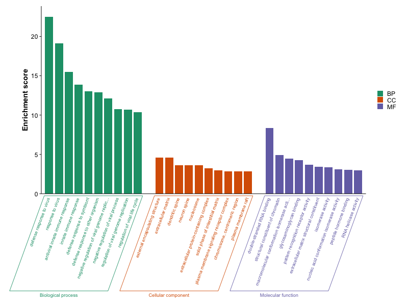
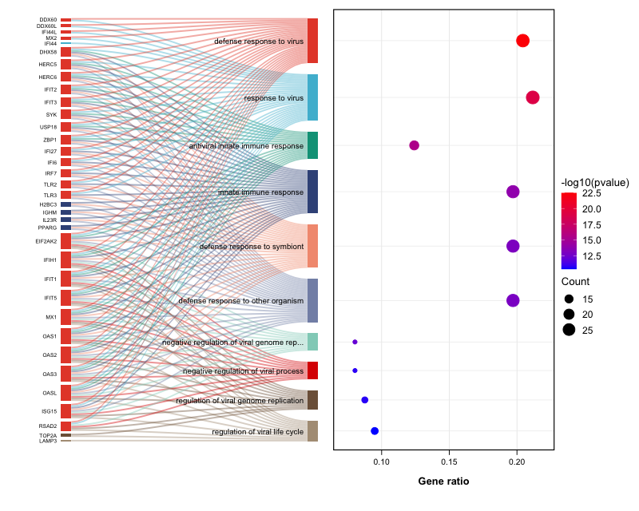
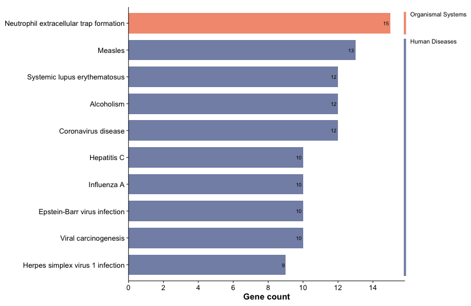
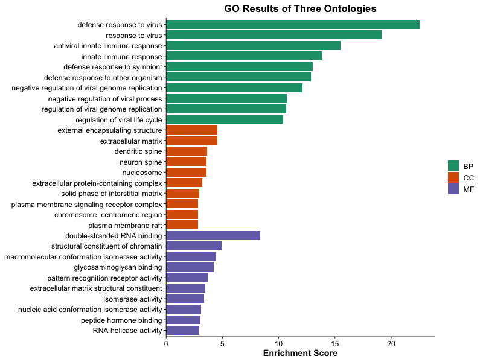
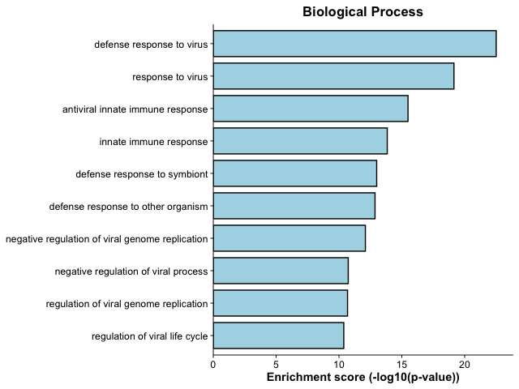
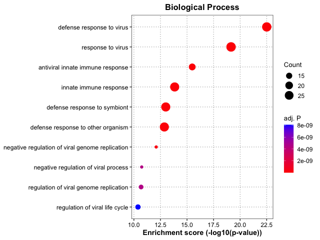
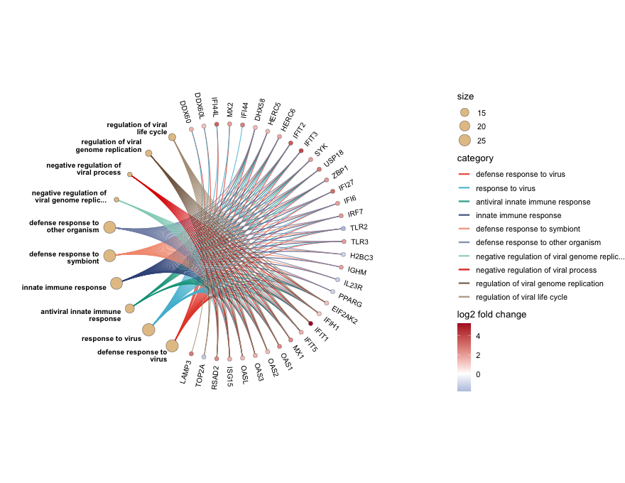
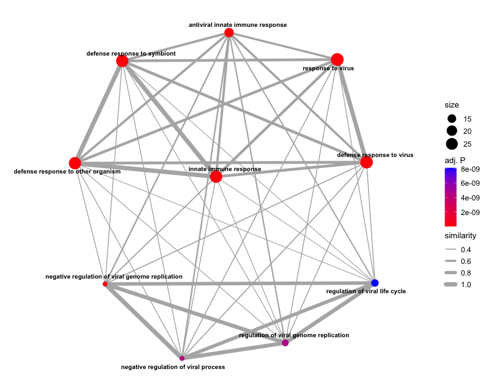
</p>

All of these are drawn from the example files above (the KEGG category plot at
p ≤ 0.05, the rest at adjusted p ≤ 0.05). The first eight are plain
ggplot2 working on the result tables, so they behave identically for imported
and freshly computed results and need no Bioconductor package.

**Figure options** cover the colour set (NPG, Lancet, AAAS, JAMA, NEJM, JCO,
Frontiers, or the figure's own default), bar colour, values printed on bars and
their decimal places, label angle and y ticks for the three-in-one plot, Sankey
and dot-panel widths, the maximum number of genes drawn, the enrichment-map
similarity threshold, label length and font family. The usual **Titles & axis
labels** and **Fonts, points & labels** panels apply as on every other tab. For
the Sankey + dot plot the x-axis label field names the dot panel's axis and the
y-axis label field names its colour legend.

### Exports

- Each figure exports to **TIFF, PDF and PNG**; width and height follow the
  figure type until you change them.
- **Tables**: all terms or significant terms, one workbook with a sheet per
  database.
- **Complete results bundle**: one `.zip` with every table and figure for every
  loaded database:

```
go/       go.BP.all.xlsx  go.BP.sig.xlsx
          BP_Enrichment_Score_barplot.{png,pdf,tiff}  BP_Enrichment_Score_dotplot.*
          BP_cnetplot.*  BP_emapplot.*  BP_goplot.*          (and the same for CC, MF)
          GO_Three_Ontologies.*  GO_BP_CC_MF_three_in_one.*
pathway/  pathway.all.xlsx  pathway.sig.xlsx
          Pathway_Enrichment_Score_barplot.*  Pathway_Enrichment_Score_dotplot.*
          Pathway_cnetplot.*  Pathway_emapplot.*  Pathway_sankey_dot.*
          Pathway_category_summary.*  hsaNNNNN.pathview.png
bundle_log.txt
```

  A figure that cannot be drawn (a missing optional package, no significant
  terms) is skipped and recorded in `bundle_log.txt`; the rest of the bundle is
  still written. Pathway maps are included only when the box is ticked, since
  each one is a download from KEGG.

### Gallery notes

- **KEGG classes** are derived from the pathway id (`hsa04110` → Cellular
  Processes), so the category plot needs KEGG ids in the `ID` column. Pathways
  given by name only are grouped as *Unclassified*.
- **Sankey and network plots** cap the number of genes drawn (default 100),
  keeping the genes shared by the most terms, and say so in the subtitle.
- **GO graph from imported tables** rebuilds a clusterProfiler result from the
  table before calling `goplot`, which needs real GO ids in the `ID` column.

---

## Normalisation methods

All implemented in base R, so DESeq2 and edgeR are *not* required to obtain
their normalisations.

| Method | Formula / algorithm | Needs lengths |
|---|---|---|
| CPM | `count / library size × 1e6` | no |
| TPM | `rate = count / length`; `rate / Σrate × 1e6` | **yes** |
| FPKM / RPKM | `count / (length/1000 × libsize/1e6)` | **yes** |
| DESeq2 | median-of-ratios size factors (Anders & Huber 2010) | no |
| edgeR TMM | trimmed mean of M-values (Robinson & Oshlack 2010) | no |
| log2 variants | `log2(value + 1)` | as above |

Validated against the bundled data: TPM and CPM sum to exactly 1 × 10⁶ per
sample, TMM factors multiply to 1, and the DESeq2 path matches DESeq2's own
normalised counts exactly.

> RSEM emits non-integer *expected* counts. They are used as-is for
> CPM/TPM/FPKM; for the DESeq2 and TMM paths they behave like counts and are
> handled without rounding, which keeps the size factors stable.

---

## Repository layout

```
DEGexplorer/
├── app.R                      # entry point
├── R/
│   ├── utils_io.R             # readers, format detection, DE adapters
│   ├── utils_normalise.R      # CPM / TPM / FPKM / DESeq2 / TMM
│   ├── utils_theme.R          # shared ggplot theme + font/point control
│   ├── utils_export.R         # TIFF/PDF export, gene-set resolver
│   ├── plots_de.R             # volcano, MA, expression scatter
│   ├── plots_qc.R             # PCA, scree, correlation, heatmap
│   ├── enrichment.R           # GO / KEGG / MSigDB ORA and its plots
│   ├── enrichment_tables.R    # gallery: table import, KEGG classes, bundle helpers
│   ├── plots_enrichment.R     # gallery: figures and the results bundle
│   ├── gene_report.R          # database links, live lookups, HTML dossier
│   ├── sheet_editor.R         # in-app sample sheet editor (Analysis and Data tabs)
│   ├── organisms.R            # organism registry: ids, OrgDb, KEGG code, Ensembl names
│   ├── annotation_sources.R   # Ensembl / GENCODE GTF download, gene lengths, transcripts
│   ├── transcripts.R          # transcript-level inputs: Salmon / kallisto / RSEM, tx2gene, Ng vector
│   ├── de_analysis.R          # DESeq2, limma-voom, edgeR and EBSeq engines
│   ├── dtu.R                  # transcript usage: edgeR / limma diffSplice, DEXSeq, DRIMSeq, satuRn
│   ├── de_qc.R                # Analysis-tab QC figures
│   ├── de_report.R            # run record, reproducible R script, bundle, design files
│   ├── analysis_ui.R          # Analysis tab layout
│   ├── analysis_server.R      # Analysis tab logic
│   ├── gene_explorer.R        # Gene explorer tab, full gene lists
│   ├── ui.R                   # user interface
│   └── server.R               # reactive logic
├── data/                      # bundled example (anonymised; gzipped)
│   └── example_enrichment/    # example import files for the gallery (+ SOURCE.txt provenance)
├── data-raw/                  # rebuilds the example result tables, enrichment tables and README figures
├── man/figures/               # gallery figures shown in this README
├── tests/smoke_test.R         # end-to-end checks on the bundled data
├── CITATION.cff               # how to cite (GitHub's "Cite this repository")
├── NEWS.md                    # release notes
├── renv.lock                  # package versions the release was tested with
├── LICENSE
└── README.md
```

---

### Enrichment results table

The table lists the usual clusterProfiler statistics plus gene-membership
columns: `Genes` (symbols) and `Ensembl IDs` for every database, and
`Entrez IDs` additionally for KEGG — the one database clusterProfiler runs on
Entrez accessions rather than Ensembl. The native ids are kept rather than
discarded, and databases that never produce them get no empty column. Ids with
no symbol in the loaded DE table keep their accession, so nothing is dropped.

A GO term can carry hundreds of genes, which previously made one table row
hundreds of pixels tall and pushed the figure far below the fold. Every gene
column now shows the first three entries with a `+N more` toggle; click it to
expand that cell in place. Wide numeric columns are rounded and p-values shown
in scientific notation.

CSV and Excel downloads contain the full, plain-text lists in every gene
column — the collapsing is display only.

---

### Annotating from a GTF

The gene-annotation slot accepts the same `.gtf` / `.gtf.gz` your aligner and
pipeline used, so there is no need to prepare an id/symbol TSV or CSV at
all. Gene id, symbol, biotype, chromosome, start, end and strand are read
straight out of it, along with whatever else the file carries (`gene_version`,
`gene_source`, `level`, `tag`, …), and those columns ride along on the DE table
and into the exports.

- GTF and GFF3 are both understood, plain or gzipped, and the format is
  detected from the file's contents rather than its name.
- Only `gene` records are used. Annotations without them — a StringTie
  assembly, for instance — fall back to `transcript` records, deduplicated by
  gene id.
- GENCODE writes versioned ids (`ENSG00000223972.5`) where most count
  pipelines write bare ones. Matching strips the suffix when a direct match
  fails, so a GENCODE GTF lines up with an Ensembl-id results table without
  any manual editing.
- The file is streamed in chunks, so a full human annotation never has to sit
  in memory at once. Uploads are capped at 2 GB; gzipped is much quicker.

---

## Figure export

Every plot tab has **TIFF** and **PDF** buttons with width, height and DPI
controls (the Enrichment gallery adds **PNG**). All formats go through one code path: a graphics device is opened,
the figure is drawn, the device is closed, and the result is only handed to the
browser once it has been verified non-empty.

- PDFs are written with `cairo_pdf(onefile = TRUE)`, falling back to `pdf()` on
  R builds without cairo. The `onefile = TRUE` matters: with cairo's default of
  `FALSE`, any figure that draws more than one page — stacked Up/Down enrichment
  panels, grid-based grobs, `enrichplot` network layouts — overwrites its own
  output and the download arrives empty or never completes.
- TIFF falls back from LZW to uncompressed to PNG if a device refuses to open.
- ggplot, ggraph (`cnetplot`/`emapplot`), patchwork, pheatmap and raw gtables
  are all handled.
- If a figure cannot be built or rendered, the download still returns a valid
  one-page file stating the reason, and a red notification appears in the app,
  rather than the button appearing to do nothing.

---

## Notes and limitations

- **Enrichment needs the organism's OrgDb.** GO and KEGG for a non-human
  organism need its Bioconductor OrgDb package; organisms without one can still
  use MSigDB (when `msigdbr` covers them) or imported enrichment tables.
- **Direction of log2 fold change** follows whichever group your DE pipeline
  treated as the reference. The app reports what it is given; check your design
  before interpreting the sign.
- **Live gene lookups** depend on third-party APIs (MyGene.info, Europe PMC)
  that may rate-limit or change. The link layer is the dependable part; live
  fetching is an optional extra and is off by default.
- Network-style enrichment plots (gene-concept network, enrichment map,
  gene-term heatmap) need `enrichplot`, and stacking up/down panels for them
  needs `gridExtra`.

---

## How to cite DEGexplorer

If DEGexplorer contributes to your work, please cite it. GitHub's **"Cite this
repository"** button (from [`CITATION.cff`](CITATION.cff)) gives the reference in
APA and BibTeX:

> Imam, M. K. *DEGexplorer: an interactive workbench for RNA-seq differential
> expression, transcript expression and transcript usage* (version 1.0.0).
> CSIR-Institute of Genomics and Integrative Biology / Academy of Scientific and
> Innovative Research. https://github.com/Kaisarimam/DEGexplorer

Please also cite the analysis methods you used, listed below.

## Citing the resources used

If a figure from this app ends up in a manuscript, please cite the underlying
methods and databases you relied on — DESeq2, limma/voom, edgeR or EBSeq for
the differential testing (and for transcript-level work: tximport, edgeR's
divided counts, stageR; for transcript usage: the DTU method used and Love et al.
2018 or Baldoni et al. 2025), clusterProfiler and the relevant ontology for enrichment, MSigDB for
gene sets, and MyGene.info / Europe PMC if you used the live lookups.

---

## Licence

DEGexplorer is released under the MIT licence — see [LICENSE](LICENSE).

**Third-party data shipped with it.** `data/go_release/` and the GO tables in
`data/example_enrichment/` are derived from Gene Ontology Consortium data
(ontology and UniProt-GOA human annotations, release 2026-07-26), distributed
under the [Creative Commons Attribution 4.0](https://creativecommons.org/licenses/by/4.0/)
licence; © Gene Ontology Consortium. Cite: Gene Ontology Consortium,
*Genetics* 2023, 224(1):iyad031, and Ashburner et al., *Nat Genet* 2000, 25:25–29.
No KEGG data are redistributed: KEGG pathways are fetched live from the KEGG
REST API when you run an analysis, under KEGG's own terms
(https://www.kegg.jp/kegg/legal.html). The example dataset is anonymised RNA-seq
data (see `data/example_samplesheet.csv`); sample labels and values do not
identify the original study.
